  

<h1 align="center">Hi, I'm Mukadus Jawaid 👋</h1>

  <b>Software Engineer · Frontend Engineer</b> 
  Building scalable, user-focused web apps with React, Next.js and TypeScript. 
  Karachi, Pakistan 🇵🇰

  
  
  
  

---

## 👩‍💻 About me

- 💼 Front-End Engineer at **Cloud Primero**, working on SaaS and AI products with **TypeScript** and **Next.js**: architecture, features, i18n and performance.
- 🚀 Previously Associate React.js Developer at **Tafsol Technologies**, where I cut load times by ~30%, shipped SSR/CSR apps and built an offline-capable PWA.
- 🎓 B.S. Software Engineering, **Sir Syed University** (CGPA 3.77, Bronze Medalist). Former General Secretary of IEEE Computer Society.
- 🌱 Currently learning **Node.js and backend development** to grow into a well-rounded software engineer.
- 🎨 I also do graphic and UI design, so I care about how things look as much as how they work.

## 🛠️ Tech stack

**Languages**

**Frontend**

**Backend & tools**

## 📂 Featured projects

| Project | What it is | Stack |
| --- | --- | --- |
| **[Wattwise](https://wtq26-mukadus-jawaid.vercel.app/)** | AI tool that decodes Pakistani electricity bills (K-Electric, LESCO, IESCO): extracts every charge and tax, then answers questions using only what's on the bill. Built for Women Tech Quest 2026 | AI, Next.js, Vercel |
| **Capra Vision** | AI-powered mobile app that classifies goat breeds (my final year project, top innovation scores) | React Native, Node.js, AI |
| **[DreamEscape](https://github.com/MukadusJawaid/DreamEscape)** | Dream-themed web project | HTML, CSS |
| **[Emojipedia](https://github.com/MukadusJawaid/Emojipedia)** | Emoji directory with descriptions | React, JavaScript |
| **Caropedia · Notes Keeper · Melad Zone · Tutor Elli** | Live web projects, see my portfolio for demos | React, Next.js |

👉 See everything live at **[my portfolio](https://mukadusjawaid.vercel.app)**.

## 🤝 Let's connect

I'm always happy to talk frontend, AI products, design, or opportunities. The best way to reach me is through [LinkedIn](https://www.linkedin.com/in/mukadusjawaid) or [email](mailto:mukadus.jawaid.dev@gmail.com).

<i>Thanks for stopping by! ⭐</i>

